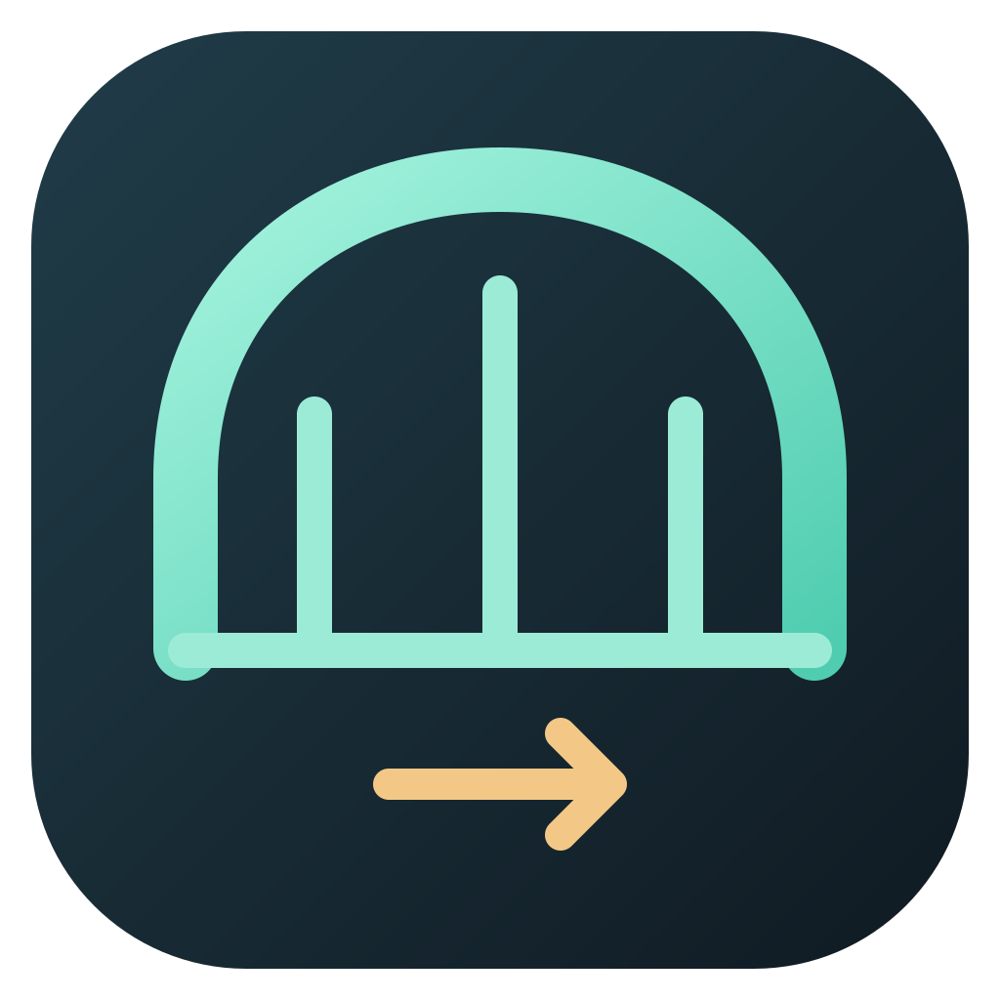
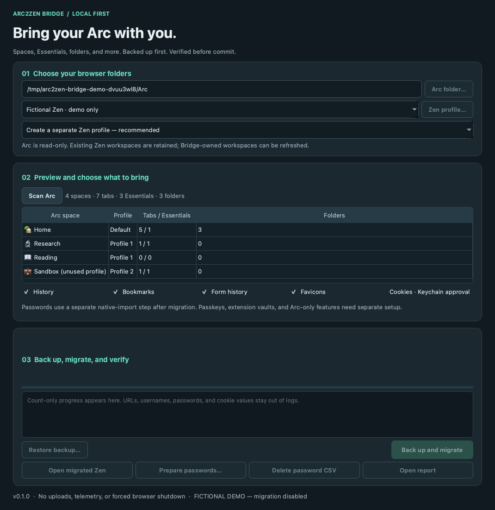

<p align="center"></p>

# Arc2Zen Bridge

**Bring your Arc spaces to Zen—with full local backups and a verified migration.**

An independent macOS desktop app and CLI. Includes fixes for Essentials-only
spaces, shared-profile Essentials, unused profiles, empty/nested folders, and
Zen's two session stores. This is a **v0.1 developer preview**, not a promise that
every Arc feature can be cloned into another browser.

[Download the macOS app](https://github.com/MohamedRF/arc2zen-bridge/releases) · [Compatibility](docs/compatibility.md)
· [Privacy](docs/privacy.md) · [Recovery](docs/recovery.md)



## What it brings

| Data | Behavior |
|---|---|
| Spaces | Preserves order, names, emoji, empty spaces, and Essentials-only spaces |
| Tabs | Pinned tabs, Essentials, and open tabs in both Zen session stores |
| Folders | Nested hierarchy, sibling order, and empty-folder anchors |
| Profiles | Separate Zen containers; Essentials shared only within the original profile |
| Appearance | Approximate workspace colors, cached favicons, single-toolbar layout |
| Bookmarks | Adds regular bookmarks under a labelled import folder; keeps existing bookmarks |
| History | Imports supported visits and dates; deduplicates by URL/date/type |
| Form history | Saved text-field entries, when the initialized target supports the schema |
| Cookies | Optional Keychain approval; preserves expiry and profile context; excludes partitioned cookies |
| Passwords | Separate, explicit preparation of a private CSV for **Zen's native importer** |

Arc remains read-only. By default, Bridge creates a **separate Zen profile** from
your initialized template. Updating an existing profile is an explicit option;
only previously Bridge-owned workspace state is refreshed. It never runs a
“clear the whole Zen profile” operation.

## Use the app

1. Download the ZIP or DMG for Apple Silicon (`arm64`) or Intel (`x64`). Move
   **Arc2Zen Bridge.app** into Applications. macOS 14 or newer is required.
2. Run Zen once and quit it normally, so it creates its profile and saved window.
3. Open Bridge, select the Arc data folder and initialized Zen template, then
   **Scan Arc**. Review the workspace and tab counts.
4. Quit both Arc and Zen. Choose optional data imports. Click **Back up & migrate**.
5. Bridge hashes full backups, writes to a staging folder, verifies URLs, folder
   paths, profile separation, and matching session IDs, then commits the result.
6. Use **Open migrated Zen**. A new-profile migration does **not** change Zen's
   default profile or register it globally; keep the reported profile path and
   use this launch button, or configure it in Zen's profile manager yourself.

Builds are ad-hoc signed, **not Apple-notarized**. Do not disable Gatekeeper or
browser security settings. If macOS does not allow the download to run, build
from source or use Apple's normal reviewed-app approval flow for software you
have chosen to trust.

### Passwords

After a successful migration, click **Prepare passwords…** and approve macOS
Keychain access locally. Bridge decrypts only saved Arc logins into a temporary
CSV with owner-only permissions. It does not upload credentials, ask for your
Mac password, or install anything into Zen's password store directly.

Import the CSV in **Zen → Settings → Import Data → Passwords from CSV**, then
click **Delete password CSV** in Bridge. The preparation report contains counts,
not passwords. Different passwords for the same site and username block CSV
preparation rather than silently selecting one. Passkeys and Bitwarden/other
extension vaults need their own supported sign-in/export workflow.

## Run from source

```sh
python3 -m venv .venv
source .venv/bin/activate
python -m pip install -e '.[dev]'
arc2zen-bridge-app
```

Show a **fictional, read-only preview** without scanning any real browser data:

```sh
arc2zen-bridge-app --demo
```

### CLI

```sh
arc2zen-bridge scan --arc "$HOME/Library/Application Support/Arc"

arc2zen-bridge migrate \
  --arc "$HOME/Library/Application Support/Arc" \
  --zen "$HOME/Library/Application Support/zen/Profiles/EXAMPLE.default" \
  --yes
```

The CLI defaults to a new profile. `--replace` explicitly updates the selected
profile, `--cookies` explicitly requests Keychain access, and `--no-history`,
`--no-bookmarks`, `--no-forms`, and `--no-favicons` disable individual imports.
Run folders are stored under `~/Library/Application Support/Arc2Zen Bridge/runs`.
Browser-data output is refused inside a Git repository or either browser folder.

```sh
arc2zen-bridge prepare-passwords /path/to/completed-run --yes
arc2zen-bridge delete-password-csv /path/to/completed-run
arc2zen-bridge restore /path/to/completed-replacement-run --yes
```

## Build and test

```sh
pytest -q
ruff check .
ruff format --check .
python scripts/check_public_tree.py
python scripts/build_macos.py
```

The build produces a self-contained `.app`, ZIP, DMG, and SHA-256 checksums in
`dist/`. Build on Apple Silicon for `arm64`, or on Intel for `x64`. Tagged releases
build both architectures through GitHub Actions. The app does not embed Python
from, or depend on, another migration application's installation.

All regression tests and the screenshot use **fictional fixtures generated from
code**. No browser profiles, browsing URLs, emails, passwords, cookie values,
exports, or user migration reports belong in this repository. Build artifacts,
browser files, CSVs, JSON runtime files, and backups are ignored by Git and checked
again before publication.

## Limits

Zen is not a pixel-identical Arc clone. Arc-only features, archive UI, passkeys,
site storage/IndexedDB, historical Downloads lists, and extension vaults/settings
are not automatically migrated. Extension installation and its permissions remain
the user's decision. Cookies may not preserve every sign-in. See the
[compatibility guide](docs/compatibility.md) before migrating important data.

## Acknowledgments

[Thinkscape/arc-to-zen](https://github.com/Thinkscape/arc-to-zen) and
[rafcabezas/arc2zen](https://github.com/rafcabezas/arc2zen) are useful references for
the migration problem and Zen's session behavior. Arc2Zen Bridge is a new,
independent implementation, not a fork or a wrapper around either repository.
See [third-party notices](THIRD_PARTY_NOTICES.md) for runtime components and format
references. Own code: [MIT](LICENSE).
